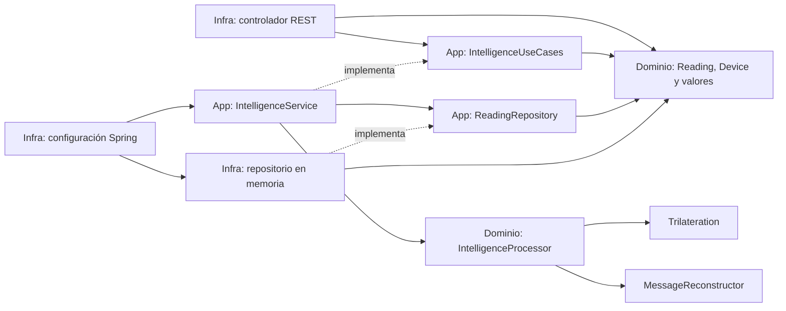

# Diseño y justificación

## Lenguaje del dominio

- **Dispositivo**: identidad y posición fija de un punto de vigilancia.
- **Lectura**: información temporal completa de un dispositivo: identidad, distancia y fragmento del mensaje.
- **Posición**: coordenadas del laboratorio.
- **Resultado de inteligencia**: posición y mensaje reconstruidos a partir de las tres lecturas.

El contexto delimitado es la reconstrucción de inteligencia de vigilancia. No se modelan metahumanos, usuarios, ventas ni laboratorios persistidos: el enunciado no requiere administrar esos conceptos.

## Modelo DDD

`Device` representa las tres identidades permitidas y sus coordenadas inmutables. `Reading` representa la instantánea del agregado de información de un dispositivo; su identidad estable es `device`. Es inmutable y valida sus invariantes al construirse; las actualizaciones producen una nueva instantánea con la misma identidad. La igualdad estructural de un record permite comparar instantáneas, y el repositorio garantiza una sola lectura vigente por identidad.

`Position` e `IntelligenceResult` son objetos de valor inmutables. `IntelligenceProcessor` es un servicio de dominio porque la trilateración y la combinación de tres fragmentos involucran varias lecturas y no pertenecen a una lectura individual.

`Trilateration` encapsula exclusivamente el cálculo y refinamiento numérico de la posición. Es un colaborador interno del dominio, sin anotaciones de Spring, acceso a HTTP ni almacenamiento.

`MessageReconstructor` combina los fragmentos recibidos conservando sus índices originales. La reconstrucción y el cálculo geométrico son colaboradores separados del mismo servicio de dominio.

El modelo evita componentes artificiales para este dominio pequeño. No requiere persistencia, ORM, eventos distribuidos ni múltiples contextos delimitados.

## Puertos y adaptadores

Las dependencias de código siguen la dirección **infraestructura → aplicación → dominio**. Los puertos pertenecen a aplicación; sus tipos de entrada y salida usan el modelo de dominio. El flujo de ejecución de una petición puede llegar al adaptador de almacenamiento, pero la aplicación depende de su interfaz, no de esa implementación.

- `domain`: reglas de las lecturas, dispositivos, trilateración y reconstrucción. Solo depende de Java.
- `application`: orquesta casos de uso y declara puertos de entrada y salida. Solo depende del dominio y Java.
- `infrastructure/adapter/in/web`: traduce JSON a objetos de dominio y errores a respuestas HTTP. Los DTO evitan usar el formato HTTP como modelo de negocio.
- `infrastructure/adapter/out`: implementa el puerto de almacenamiento con un `EnumMap`.
- `infrastructure/config`: compone los objetos mediante beans de Spring. El dominio y la aplicación no llevan anotaciones de Spring.
- La documentación OpenAPI y Swagger UI pertenece a infraestructura: describe los DTO y controladores HTTP y no incorpora anotaciones ni dependencias a los modelos del dominio o a los puertos.
- `OperacionAlquimiaApplication`: punto de arranque de Spring Boot.

El diagrama siguiente muestra dependencias e implementaciones de tipos, no una secuencia de llamadas:

El servicio de aplicación implementa el puerto de entrada `IntelligenceUseCases` y depende del puerto de salida `ReadingRepository`. El adaptador `InMemoryReadingRepository` implementa este último. Spring realiza la composición al arrancar. `domain` y `application` usan únicamente Java estándar y tipos del núcleo; las pruebas de arquitectura comprueban que no dependan de Spring, Jackson, Swagger ni adaptadores de infraestructura.

## Decisiones técnicas y sustentación

### Almacenamiento temporal y concurrencia

Las lecturas y sus mensajes son inmutables; el repositorio entrega listas copiadas. Sus operaciones se sincronizan para comprobar existencia y mutar en una misma sección crítica. PATCH lee el valor anterior, combina campos y valida antes de guardar, bajo el mismo bloqueo: dos actualizaciones concurrentes de campos diferentes no pierden cambios.

Un PATCH inválido deja intacta la lectura anterior. PUT, PATCH y DELETE solo afectan a una identidad. El procesamiento acumulado captura una instantánea consistente bajo bloqueo y calcula después sobre ella. El resultado corresponde a esa instantánea, aunque lleguen otras actualizaciones durante el cálculo.

### Reconstrucción del mensaje

Los fragmentos pueden tener distinta longitud. El índice de cada cadena identifica su posición en el mensaje original desde el índice 0; el dominio recorre hasta la longitud del fragmento más largo. Una posición final omitida y una cadena `""` representan ausencia de información en esa posición. No se eliminan los huecos internos antes de combinar las lecturas.

Para cada posición se acepta la cadena no vacía recibida por cualquier dispositivo. Si dos cadenas recibidas en esa posición son diferentes, se informa `CONFLICTING_MESSAGE`. Si ninguna lectura aporta contenido en una posición, o todos los fragmentos son `[]`, se informa `INCOMPLETE_MESSAGE`. La comparación distingue mayúsculas y tildes y conserva literalmente las cadenas, incluidos sus espacios. Las cadenas resultantes se unen con un espacio separador.

Un fragmento `[]` puede registrarse, reemplazarse o enviarse por PATCH: constituye información incompleta que los otros dispositivos pueden completar al procesar. Se siguen rechazando arreglos o elementos `null`. Sin metadatos que indiquen un desplazamiento, no se reasignan palabras a otros índices ni se adivina su alineación.

### Refinamiento de la trilateración

Cada dispositivo define un círculo `(x-xi)^2 + (y-yi)^2 = di^2`. Restar el primer círculo de los otros dos elimina los términos cuadráticos y produce un sistema de dos ecuaciones lineales. Las tres posiciones fijas no son colineales, por lo que su determinante es distinto de cero.

Una solución del sistema lineal no garantiza por sí sola satisfacer los tres círculos. El cálculo anterior restaba directamente distancias al cuadrado; a gran escala esa operación perdía precisión y podía rechazar datos válidos.

La versión corregida:

1. Calcula `d1² - d2²` como `(d1 - d2) * (d1 + d2)` para reducir la cancelación numérica.
2. Obtiene una estimación inicial con el sistema lineal y `Math.fma`.
3. Refina los residuos de las distancias mediante pasos de Gauss-Newton, con retroceso si un paso no mejora el error. Los pasos se resuelven por QR con rotaciones de Givens, sin formar las ecuaciones normales `JᵀJ`.
4. Limita el trabajo a 20 iteraciones y 16 intentos de retroceso por iteración.
5. Valida las tres distancias por separado y solo acepta residuos finitos dentro de la tolerancia configurada (0,01 unidades por defecto). Si no se encuentra una posición compatible, informa `INCONSISTENT_DISTANCES`.

Este refinamiento mejora la precisión sin ampliar la tolerancia ni ocultar datos incompatibles. El objetivo numérico de parada también se ajusta a la tolerancia solicitada para no detenerse prematuramente ante una configuración más estricta.

La tolerancia se recibe en el constructor de dominio y se valida como finita y estrictamente positiva. `DomainConfiguration` traduce la propiedad `alquimia.distance-tolerance` a ese parámetro; `application.properties` permite suministrarla mediante `DISTANCE_TOLERANCE`. El dominio no conoce Spring ni las variables de entorno. Una configuración inválida falla durante el arranque, antes de aceptar peticiones.

Las distancias de entrada deben ser finitas y no negativas, sin un máximo de negocio artificial. Las operaciones usan `double` y deben producir una posición finita compatible con las tres lecturas. Magnitudes extremas pueden perder precisión o impedir obtener ese resultado; no se garantiza procesar todo valor finito representable. La tolerancia controla las distancias reconstruidas. La precisión de las coordenadas también depende de la geometría: cuando el objetivo está muy lejos del conjunto de sensores, la incertidumbre angular aumenta.

Referencias del método: [NIST: iteración de Gauss-Newton](https://www.nist.gov/publications/fitting-natures-basic-functions-part-iii-exponentials-sinusoids-and-nonlinear-least) y [LAPACK: factorizaciones ortogonales para mínimos cuadrados](https://www.netlib.org/lapack/lug/node39.html).

## Cobertura del enunciado

| Funcionalidad | Puerto de entrada y método | Dominio o invariantes | Adaptador HTTP |
| --- | --- | --- | --- |
| 2.1 Información completa | `IntelligenceUseCases.process` | `IntelligenceProcessor`, `Trilateration` y `MessageReconstructor`: tres dispositivos distintos y datos reconstruibles | `POST /api/intelligence` |
| 2.2 Registro individual | `IntelligenceUseCases.register` | `Device` y `Reading`: identidad conocida, distancia finita no negativa, mensaje de cadenas no nulas; una lectura por dispositivo | `POST /api/readings/{device}` |
| 2.3 Consulta y procesamiento acumulado | `IntelligenceUseCases.find`, `findAll`, `processStored` | Instantánea inmutable; los mismos servicios de cálculo y reconstrucción del procesamiento completo | `GET /api/readings`, `GET /api/readings/{device}`, `GET /api/intelligence` |
| 2.4 Reemplazo completo | `IntelligenceUseCases.replace` | Lectura existente; nueva `Reading` con distancia y mensaje completos, conservando las demás identidades | `PUT /api/readings/{device}` |
| 2.5 Actualización parcial | `IntelligenceUseCases.update` | Lectura existente; combinación de campos omitidos con valores anteriores y validación antes de guardar | `PATCH /api/readings/{device}` |
| 2.6 Eliminación | `IntelligenceUseCases.delete` | Lectura existente; eliminación exclusiva de su identidad, sin alterar los otros registros | `DELETE /api/readings/{device}` |

`IntelligenceService` implementa estos casos de uso y coordina el dominio con `ReadingRepository`. Los estados HTTP, los DTO y el contrato OpenAPI corresponden al adaptador de entrada; el repositorio en memoria resuelve las operaciones atómicas del puerto de salida.

## Verificación

La suite contiene 90 pruebas. `ArchitectureTest` inspecciona los imports del núcleo y sus dependencias compiladas con `jdeps`, además de comprobar las interfaces de los puertos y sus implementaciones. Esta comprobación impide que una referencia totalmente cualificada o una anotación de framework pase inadvertida por no figurar como un import explícito.

- Dominio: coordenadas conocidas, orden de llegada, ubicación sobre un dispositivo, faltantes, duplicados, distancias incompatibles, tolerancia configurable, palabras contradictorias, fragmentos vacíos o de distinta longitud, posiciones sin palabra e inmutabilidad.
- Aplicación y repositorio: aislamiento entre dispositivos, PUT frente a PATCH, rechazo sin mutación y actualizaciones concurrentes.
- HTTP: servidor real con puerto aleatorio, procesamiento completo sin efectos de almacenamiento, ciclo de registro/procesamiento/actualización/eliminación, estados, Location, alias de dispositivos y errores de contrato. La descripción `/v3/api-docs` y la entrada de Swagger se comprueban desde esta capa.
- Arquitectura: independencia de `domain` y `application` respecto de Spring, Jackson, Swagger e infraestructura. Las anotaciones para documentación de la API permanecen en infraestructura.
- Portabilidad: Maven Wrapper para ambos tipos de shell, compilación con `--release 17` y matriz CI de tres sistemas con JDK 17, 21 y 25. Las verificaciones locales se informan por separado de la configuración y de los resultados de CI.

El [procedimiento de verificación](verification.md) relaciona las seis funcionalidades con los endpoints y las clases de prueba y permite comprobarlas manualmente sin instalar herramientas adicionales al JDK y un cliente HTTP como curl. La documentación describe la separación DDD y Hexagonal verificable en el código; no presupone convenciones particulares de clase que no estén especificadas en el enunciado.
