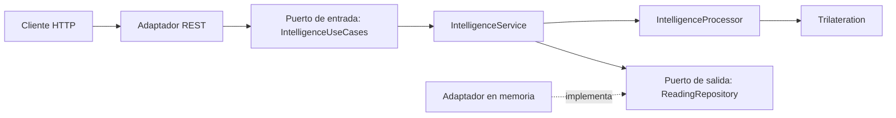

# Diseño y justificación

## Lenguaje del dominio

- **Dispositivo**: identidad y posición fija de un punto de vigilancia.
- **Lectura**: información temporal completa de un dispositivo: identidad, distancia y fragmento del mensaje.
- **Posición**: coordenadas del laboratorio.
- **Resultado de inteligencia**: posición y mensaje reconstruidos a partir de las tres lecturas.

El contexto delimitado es la reconstrucción de inteligencia de vigilancia. No se modelan metahumanos, usuarios, ventas ni laboratorios persistidos: el enunciado no requiere administrar esos conceptos.

## Modelo DDD

`Device` representa las tres identidades permitidas y sus coordenadas inmutables. `Reading` representa la instantánea del agregado de información de un dispositivo; su identidad estable es `device`. Es inmutable y valida sus invariantes al construirse; las actualizaciones producen una nueva instantánea con la misma identidad. La igualdad estructural de un record permite comparar instantáneas, y el repositorio garantiza una sola lectura vigente por identidad.

`Position` e `IntelligenceResult` son objetos de valor inmutables. `IntelligenceProcessor` es un servicio de dominio porque la trilateración y la combinación de tres fragmentos involucran varias lecturas y no pertenecen a una lectura individual.

`Trilateration` encapsula exclusivamente el cálculo y refinamiento numérico de la posición. Es un colaborador interno del dominio, sin anotaciones de Spring, acceso a HTTP ni almacenamiento.

El modelo evita componentes artificiales para este dominio pequeño. No requiere persistencia, ORM, eventos distribuidos ni múltiples contextos delimitados.

## Puertos y adaptadores

```text
Cliente HTTP
    |
    v
IntelligenceController / DTO / ApiExceptionHandler       adaptador de entrada
    |
    v
IntelligenceUseCases                                    puerto de entrada
    |
    v
IntelligenceService                                     aplicación
    |                         |
    v                         v
IntelligenceProcessor      ReadingRepository             dominio / puerto de salida
                              ^
                              |
                       InMemoryReadingRepository         adaptador de salida
```

- `domain`: reglas de las lecturas, dispositivos, trilateración y reconstrucción. Solo depende de Java.
- `application`: orquesta casos de uso y declara puertos de entrada y salida. Solo depende del dominio y Java.
- `infrastructure/adapter/in/web`: traduce JSON a objetos de dominio y errores a respuestas HTTP. Los DTO evitan usar el formato HTTP como modelo de negocio.
- `infrastructure/adapter/out`: implementa el puerto de almacenamiento con un `EnumMap`.
- `infrastructure/config`: compone los objetos mediante beans de Spring. El dominio y la aplicación no llevan anotaciones de Spring.
- `OperacionAlquimiaApplication`: punto de arranque de Spring Boot.

La dependencia de código apunta hacia el núcleo. El servicio de aplicación conoce la interfaz `ReadingRepository`, y Spring le entrega su implementación al arrancar.



## Consistencia

Las lecturas y sus mensajes son inmutables; el repositorio entrega listas copiadas. Sus operaciones se sincronizan para comprobar existencia y mutar en una misma sección crítica. PATCH lee el valor anterior, combina campos y valida antes de guardar, bajo el mismo bloqueo: dos actualizaciones concurrentes de campos diferentes no pierden cambios.

Un PATCH inválido deja intacta la lectura anterior. PUT, PATCH y DELETE solo afectan a una identidad. El procesamiento acumulado captura una instantánea consistente bajo bloqueo y calcula después sobre ella. El resultado corresponde a esa instantánea, aunque lleguen otras actualizaciones durante el cálculo.

## Trilateración

Cada dispositivo define un círculo `(x-xi)^2 + (y-yi)^2 = di^2`. Restar el primer círculo de los otros dos elimina los términos cuadráticos y produce un sistema de dos ecuaciones lineales. Las tres posiciones fijas no son colineales, por lo que su determinante es distinto de cero.

Una solución del sistema lineal no garantiza por sí sola satisfacer los tres círculos. El cálculo anterior restaba directamente distancias al cuadrado; a gran escala esa operación perdía precisión y podía rechazar datos válidos.

La versión corregida:

1. Calcula `d1² - d2²` como `(d1 - d2) * (d1 + d2)` para reducir la cancelación numérica.
2. Obtiene una estimación inicial con el sistema lineal y `Math.fma`.
3. Refina los residuos de las distancias mediante pasos de Gauss-Newton, con retroceso si un paso no mejora el error. Los pasos se resuelven por QR con rotaciones de Givens, sin formar las ecuaciones normales `JᵀJ`.
4. Limita el trabajo a 20 iteraciones y 16 intentos de retroceso por iteración.
5. Valida las tres distancias por separado y solo acepta residuos finitos de como máximo 0,01 unidades. Si no se encuentra una posición compatible, informa `INCONSISTENT_DISTANCES`.

Este refinamiento mejora la precisión sin ampliar la tolerancia ni ocultar datos incompatibles. Las operaciones usan `double`; el límite de entrada evita desbordamientos. La tolerancia controla las distancias reconstruidas. La precisión de las coordenadas también depende de la geometría: cuando el objetivo está muy lejos del conjunto de sensores, la incertidumbre angular aumenta.

Referencias del método: [NIST: iteración de Gauss-Newton](https://www.nist.gov/publications/fitting-natures-basic-functions-part-iii-exponentials-sinusoids-and-nonlinear-least) y [LAPACK: factorizaciones ortogonales para mínimos cuadrados](https://www.netlib.org/lapack/lug/node39.html).

## Cobertura del enunciado

| Funcionalidad | Caso de uso |
| --- | --- |
| 2.1 Información completa | `process` |
| 2.2 Registro individual | `register` |
| 2.3 Consulta y procesamiento acumulado | `find`, `findAll`, `processStored` |
| 2.4 Reemplazo completo | `replace` |
| 2.5 Actualización parcial | `update` |
| 2.6 Eliminación | `delete` |

## Verificación

- Dominio: coordenadas conocidas, orden de llegada, ubicación sobre un dispositivo, faltantes, duplicados, distancias incompatibles, palabras contradictorias, posiciones sin palabra e inmutabilidad.
- Aplicación y repositorio: aislamiento entre dispositivos, PUT frente a PATCH, rechazo sin mutación y actualizaciones concurrentes.
- HTTP: servidor real con puerto aleatorio, procesamiento completo sin efectos de almacenamiento, ciclo de registro/procesamiento/actualización/eliminación, estados, Location y errores de contrato.
- Portabilidad: Maven Wrapper para ambos tipos de shell, compilación Java 21 y matriz CI de tres sistemas y dos JDK. Las verificaciones locales se informan por separado de la configuración de CI.

La suite contiene 39 pruebas ejecutables. El [procedimiento de verificación](verification.md) relaciona las seis funcionalidades con los endpoints y las clases de prueba y permite comprobarlas manualmente sin instalar herramientas adicionales al JDK y un cliente HTTP como curl.
